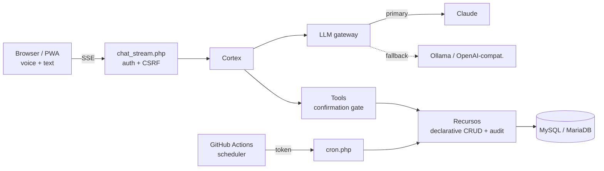

# ERL Cortex — AI Second Brain and Company Management

<div align="center">


**Voice and text AI assistant (Claude + tool use) that also runs the operations and billing of a software company**

[](https://php.net)
[](https://mariadb.org)
[](https://www.anthropic.com)
[](https://web.dev/progressive-web-apps/)
[](https://webauthn.io)
[](.)

[⭐ Highlights](#-engineering-highlights) • [📋 Features](#-features) • [🛠 Stack](#-tech-stack) • [🏗 Architecture](#-architecture) • [🔒 Security](#-security) • [✅ Quality](#-quality--testing)

</div>

---

## 🌍 Language / Idioma

<table>
<tr>
<td align="center"><a href="README.md"><b>🇧🇷 Português</b></a><br><sub>Versão em português</sub></td>
<td align="center"><b>🇺🇸 English</b><br><sub>You are here</sub></td>
</tr>
</table>

---

## 🎯 Overview

**ERL Cortex** ("Ideias em código" — *ideas into code*) is a **voice and text** AI assistant — a *second brain* — that is also, in the same app, the **operations and billing system** of a small software company. Capturing an idea, writing a note, creating a task, scheduling a reminder, issuing a Pix charge or checking a server all happen in one conversation, with **Claude** deciding which tools to call.

It is a **single owner/operator account** (not multi-tenant), shipped as **one PWA with no build step and no PHP or npm library dependencies**.

### The Problem

Ideas, notes, tasks and reminders end up scattered across different apps, while company operations (clients, recurring services, charges, servers, domains, expenses) live in yet another system. The result:
- Fragmented context: the right information is never where you are
- Recurring billing and due dates that depend on memory and spreadsheets
- No single place to ask "what do I know about this?" and get a source-backed answer
- The risk of giving an AI the power to execute financial actions without control

### The Solution

An assistant that **retrieves knowledge with semantic search and cites its sources**, **acts through tool use**, and **requires human confirmation before any financial or destructive action** — combined with a full management module and cron-driven automations, all installable on the phone with offline capture.

---

## ⭐ Engineering Highlights

- **🤖 Tool use with human confirmation**: 37 tools exposed to Claude; financial and destructive actions become a *pending action* that runs only after the user confirms, backed by an undo ledger, a 30-day trash and audit records on writes
- **🔀 One LLM gateway with a fallback chain**: the app speaks a single format (the Claude Messages API); the gateway translates to Ollama/OpenAI-compatible servers, fails over only on transient errors (timeouts, 5xx, 429) and caps paid Claude fallback usage with a daily token limit
- **🔎 Semantic search that degrades gracefully**: embeddings stored as JSON in MySQL, cosine similarity computed in PHP, automatic FULLTEXT/LIKE fallback when no embedding provider is configured; private notes never reach the external provider
- **🎙 Voice pipeline**: browser Web Speech on Chrome/Android and server-side transcription (Whisper via Groq or OpenAI) for iPhone, plus neural TTS and voice commands
- **🧠 Obsidian-style notes**: `[[wikilinks]]` with autocomplete, backlinks, `#tags`, daily note, a relation graph and Obsidian vault export; renaming a note updates its links
- **📦 Zero dependencies, by choice**: Web Push (VAPID), AWS SigV4 request signing (S3/R2 backup) and WebAuthn verification are all implemented in-house
- **⏱ Scheduler for shared hosting**: with no cron on the hosting plan, GitHub Actions calls a token-guarded HTTP endpoint at six different cadences
- **🔁 Idempotent migration** from the predecessor system (ERL DEV Gestão), with a dry-run mode and a reconciliation step

---

## 📋 Features

### 🤖 Assistant (Cortex)

- Claude Messages API (default model `claude-sonnet-5-5`, configurable) with **streaming responses (SSE)**
- **37 tools** (capture note, register payment, create charge, get date/time, and more), each carrying a confirmation flag
- **Pending-confirmation flow** for financial and destructive actions, with an **undo ledger**
- The assistant refuses to store card-like numbers (Luhn check)
- Memory layers with daily summaries, a daily plan and a morning briefing

### 🧠 Notes (Obsidian-style)

- Markdown, `[[wikilinks]]` with autocomplete, **backlinks** and `#tags`
- Daily note, a **relation graph** (capped per note to keep it readable) and Obsidian vault export
- Renaming a note updates every link that points to it

### 🔎 Search

- **Hybrid**: embeddings (Voyage) with cosine similarity in PHP + FULLTEXT/LIKE fallback
- Assistant answers grounded in the retrieved notes, **with source citations**
- Notes marked private are kept away from the external embedding provider

### 🎙 Voice

- Browser Web Speech (Chrome/Android) and **server-side transcription** (Whisper via Groq or OpenAI) for iPhone
- Neural TTS from a self-hosted endpoint, plus voice commands

### 🏢 Management

- Clients, systems, **recurring services with automatic cron billing**, charges, payments and refunds
- Servers, domains with SSL, expenses, dashboard, CSV/PDF reports and an audit log
- **Pix via Mercado Pago**: charges with a copy-and-paste code and an HMAC-verified webhook; subscriptions
- Financial changes keep before and after values
- Recurring-payment reminders via `wa.me` links

### ⚙️ Automations & Integrations

- **Cron**: morning briefing, weekly review, reminders and recurring billing
- **WhatsApp Cloud API** webhook (HMAC + number allowlist)
- **GitHub** webhook (HMAC) with repository activity events
- Uptime and incident monitoring for apps
- Vision for document photos, meeting minutes and a call log
- **Usage and cost panel**, with a daily token cap

### 📱 PWA & Mobile

- Offline reading and an **offline capture queue** (IndexedDB) synced later
- **Web Push** with VAPID, Web Share Target and manifest shortcuts
- TWA/APK path with Digital Asset Links

### 💾 Backup

- Local `.sql.gz` backups and **external backup** to S3/R2 (hand-written SigV4 signing) or WebDAV
- Restore test tool

### 🔄 Migration

- **Idempotent** importer from ERL DEV Gestão, with a simulation mode and a reconciliation script

---

## 🛠 Tech Stack

| Layer | Technology |
|-------|-----------|
| **AI** | Claude (Anthropic Messages API) with tool use + gateway with fallback to Ollama / OpenAI-compatible |
| **Embeddings / Voice** | Voyage (embeddings), Whisper via Groq or OpenAI, Web Speech API |
| **Backend** | PHP 7.4, PDO, no Composer and no libraries |
| **Database** | MySQL 5.7+ / MariaDB 10.3+ (InnoDB, utf8mb4, FULLTEXT) |
| **Frontend** | Vanilla JavaScript (ES modules), hand-written CSS, no framework and no build |
| **Mobile** | PWA: Service Worker, IndexedDB, Web Push (VAPID), Share Target, TWA |
| **Payments** | Mercado Pago (Pix + webhook) |
| **Auth** | Session + CSRF, TOTP 2FA, passkeys (WebAuthn) |
| **Scheduling** | GitHub Actions → token-guarded HTTP cron endpoint |
| **Hosting** | Shared hosting (PHP + MySQL) |

---

## 🏗 Architecture



Layers and request flow:

1. **Thin endpoint** in `public/api/` (46 files)
2. **`Api::iniciar`** checks method, authentication and CSRF on every non-GET request
3. **Domain classes**: `Recursos` (declarative CRUD engine with auditing), `Gestao`, `Tools`, `Cortex`, `Llm`
4. **PDO** to MySQL/MariaDB

```
/erl-cortex
  /public     web root: pages, api/ (46 endpoints), assets, service worker, manifest
  /src        PHP domain classes and bootstrap (security headers, config, database)
  /sql        migrations 001–014
  /cron       command-line scheduler entry
  /tests      unit suite, integration suites and Node tests
  /tools      maintenance, migration, restore test
  /docs       14 documents (deployment, security, migration...)
```

**Data model**: 48 tables across 14 migrations, grouped into chat/notes (`notas`, `nota_links`, `relacoes`, `embeddings`), productivity (`tarefas`, `lembretes`, `automacoes`, `desfazer_acoes`), management (`clientes`, `cobrancas`, `servicos_recorrentes`, `dominios`, `despesas`, `historico_gestao`), integrations/ops (`monitor_*`, `git_*`, `whatsapp_*`, `push_inscricoes`) and security (`passkeys`, `seguranca`, `tentativas_login`, `uso_diario`).

---

## 🔒 Security

- **Session**: HttpOnly, Secure-over-HTTPS, SameSite=Lax cookie; session ID regenerated on login
- **Login**: 5 attempts per 15 minutes per IP; `password_verify` runs even for unknown emails so account existence is not leaked
- **CSRF**: 32-byte token compared with `hash_equals` on every non-GET request
- **TOTP 2FA** with constant-time comparison and hashed recovery codes
- **Passkeys (WebAuthn)** with in-house verification of challenge, origin and rpId hash
- **Headers**: CSP `default-src 'self'` with no inline scripts or styles, `frame-ancestors 'none'`, HSTS, `nosniff`, `X-Frame-Options: DENY`, `Permissions-Policy`
- **Webhooks**: HMAC-SHA256 with constant-time comparison (GitHub, WhatsApp, Mercado Pago)
- **Uploads**: MIME type read from file content, random file names, stored outside the public folder
- **Cron**: the endpoint refuses to run without a token of 24+ characters
- **Directory access**: `.htaccess` blocks `config/`, `src/`, `storage/`, `sql/`, `tools/`, `docs/` and sensitive files; the real configuration is never versioned
- **Frontend**: DOM nodes are built rather than injected via `innerHTML` in the Markdown renderer and the visual layer
- **Audit trail** on writes and soft-delete with a 30-day purge

---

## ✅ Quality & Testing

Counts taken directly from the test files:

| Suite | Scope | Checks |
|-------|-------|--------|
| `tests/executar.php` | Offline unit suite (no network, throwaway config) | 209 |
| `tests/backend_integracao.php` | Integration against a real test MariaDB + a fake Ollama server | 82 |
| `tests/cerebro_integracao.php` | "Brain" integration (notes, search, relations) | 61 |
| `tests/*.test.mjs` | JS modules: brain, voice commands, transcription (Node) | 3 files |

- The integration suite **refuses to run** unless the database name contains "teste", protecting real data
- 14 versioned SQL migrations and 14 supporting documents (deployment, checklist, privacy & security, migration)
- Live verification against the real Claude API, voice providers, iOS and the final hosting is still pending

---

## 📊 Project Summary

| Aspect | Details |
|--------|---------|
| **Type** | AI PWA (second brain) + company management |
| **Stack** | PHP 7.4, MySQL/MariaDB, vanilla JavaScript, Claude API |
| **Code** | ~19.3k lines of PHP, ~8.4k of JavaScript, 850 of SQL (tracked files) |
| **Assistant tools** | 37 |
| **Tables / migrations** | 48 / 14 |
| **API endpoints** | 46 |
| **Tests** | 209 unit + 82 and 61 integration + 3 Node modules |
| **Dependencies** | None (no Composer, no npm) |
| **Status** | In active development |

---

## 👨‍💻 About the Developer

**Lucas (Erl Dev)** — Full-Stack Developer | Applied AI Engineering & PWA

- 🌐 Portfolio: [github.com/Lucas12teixeira/Portifolio-Projetos](https://github.com/Lucas12teixeira/Portifolio-Projetos)
- 💼 LinkedIn: [www.linkedin.com/in/lucas-lima-10218529a/](https://www.linkedin.com/in/lucas-lima-10218529a/)
- 🐙 GitHub: [@Lucas12teixeira](https://github.com/Lucas12teixeira)
- 🏢 Company site: [www.erldev.com.br](https://www.erldev.com.br)

---

## 📜 License & Rights

© 2024-2026 Lucas (Erl Dev). All rights reserved.

> This repository contains **portfolio documentation only**. Source code is proprietary and not included.

---

<div align="center">

[📋 Executive Summary](PROJECT_SUMMARY.md) • [🇧🇷 Português](README.md)

**Built with ❤️ and ☕ by [Lucas (Erl Dev)](https://github.com/Lucas12teixeira/Portifolio-Projetos)**

</div>
