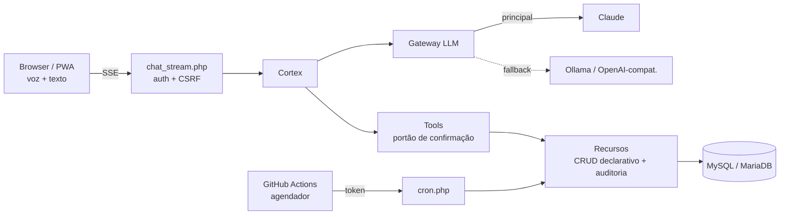

# ERL Cortex — Segundo Cérebro com IA e Gestão Empresarial

<div align="center">


**Assistente de IA por voz e texto (Claude + tool use) que também opera a gestão e a cobrança de uma empresa de software**

[](https://php.net)
[](https://mariadb.org)
[](https://www.anthropic.com)
[](https://web.dev/progressive-web-apps/)
[](https://webauthn.io)
[](.)

[⭐ Destaques](#-destaques-de-engenharia) • [📋 Funcionalidades](#-funcionalidades) • [🛠 Stack](#-stack-técnico) • [🏗 Arquitetura](#-arquitetura) • [🔒 Segurança](#-segurança) • [✅ Qualidade](#-qualidade-e-testes)

</div>

---

## 🌍 Idioma / Language

<table>
<tr>
<td align="center"><b>🇧🇷 Português</b><br><sub>Você está aqui</sub></td>
<td align="center"><a href="README-EN.md"><b>🇺🇸 English</b></a><br><sub>English version</sub></td>
</tr>
</table>

---

## 🎯 Visão Geral

**ERL Cortex** ("Ideias em código") é um assistente de IA por **voz e texto** — um *segundo cérebro* — que, no mesmo aplicativo, também é o sistema de **operação e cobrança** de uma pequena empresa de software. Capturar uma ideia, anotar, criar uma tarefa, agendar um lembrete, emitir uma cobrança Pix ou consultar um servidor acontece na mesma conversa, com o **Claude** decidindo quais ferramentas chamar.

É uma conta de **dono/operador único** (não é multi-tenant), entregue como **um único PWA, sem etapa de build e sem dependências de bibliotecas PHP ou npm**.

### O Problema

Ideias, notas, tarefas e lembretes ficam espalhados em apps diferentes, e a operação da empresa (clientes, serviços recorrentes, cobranças, servidores, domínios, despesas) vive em outro sistema. Isso causa:
- Contexto fragmentado: a informação certa nunca está onde você está
- Cobranças recorrentes e vencimentos dependentes de memória e de planilhas
- Falta de um lugar único para consultar "o que eu sei sobre isso?" com a fonte da resposta
- Risco de entregar a uma IA o poder de executar ações financeiras sem controle

### A Solução

Um assistente que **recupera conhecimento com busca semântica e cita as fontes**, **executa ações por tool use** e **exige confirmação humana antes de qualquer ação financeira ou destrutiva**, somado a um módulo de gestão completo e a automações por cron — tudo instalável no celular, com captura offline.

---

## ⭐ Destaques de Engenharia

- **🤖 Tool use com confirmação humana**: 37 ferramentas expostas ao Claude; ações financeiras e destrutivas viram uma *ação pendente* que só executa após o usuário confirmar, com ledger de desfazer, lixeira de 30 dias e auditoria nas gravações
- **🔀 Gateway único de LLM com fallback**: o app fala um só formato (Claude Messages API); o gateway traduz para Ollama/OpenAI-compatível, só faz fail-over em falhas transitórias (timeout, 5xx, 429) e limita o uso pago do Claude como reserva por um teto diário de tokens
- **🔎 Busca semântica com graceful degradation**: embeddings em JSON no MySQL, similaridade de cosseno calculada em PHP e fallback automático para FULLTEXT/LIKE quando não há provedor de embeddings; notas privadas nunca vão ao provedor externo
- **🎙 Pipeline de voz**: Web Speech no Chrome/Android e transcrição no servidor (Whisper via Groq ou OpenAI) para o iPhone, mais TTS neural e comandos de voz
- **🧠 Notas estilo Obsidian**: `[[wikilinks]]` com autocomplete, backlinks, `#tags`, nota diária, grafo de relações e exportação como vault do Obsidian; renomear atualiza os links
- **📦 Zero dependências, por escolha**: Web Push com VAPID, assinatura AWS SigV4 (backup S3/R2) e verificação WebAuthn implementados à mão
- **⏱ Agendador para hospedagem compartilhada**: sem cron no plano de hospedagem, o GitHub Actions chama um endpoint HTTP protegido por token em seis cadências diferentes
- **🔁 Migração idempotente** do sistema anterior (ERL DEV Gestão), com modo de simulação e etapa de conferência

---

## 📋 Funcionalidades

### 🤖 Assistente (Cortex)

- Claude Messages API (modelo padrão `claude-sonnet-5-5`, configurável) com **respostas em streaming (SSE)**
- **37 ferramentas** (capturar nota, registrar pagamento, criar cobrança, consultar data/hora etc.), cada uma com um indicador de confirmação
- **Fluxo de confirmação pendente** para ações financeiras e destrutivas, com **ledger de desfazer**
- O assistente se recusa a armazenar números que pareçam cartão de crédito (validação de Luhn)
- Camadas de memória com resumos diários, plano do dia e briefing matinal

### 🧠 Notas (estilo Obsidian)

- Markdown, `[[wikilinks]]` com autocomplete, **backlinks** e `#tags`
- Nota diária, **grafo de relações** (com limite por nota para manter a leitura clara) e exportação como vault do Obsidian
- Renomear uma nota atualiza os links que apontam para ela

### 🔎 Busca

- **Híbrida**: embeddings (Voyage) com similaridade de cosseno em PHP + fallback FULLTEXT/LIKE
- Respostas do assistente baseadas nas notas recuperadas, **com citação das fontes**
- Notas marcadas como privadas ficam fora do provedor externo de embeddings

### 🎙 Voz

- Web Speech do navegador (Chrome/Android) e **transcrição no servidor** (Whisper via Groq ou OpenAI) para iPhone
- TTS neural a partir de um endpoint próprio e comandos de voz

### 🏢 Gestão

- Clientes, sistemas, **serviços recorrentes com cobrança automática por cron**, cobranças, pagamentos e estornos
- Servidores, domínios com SSL, despesas, dashboard, relatórios CSV/PDF e log de auditoria
- **Pix via Mercado Pago**: cobranças com código copia-e-cola e webhook com verificação HMAC; assinaturas
- Alterações financeiras guardam valores antes e depois
- Régua de lembretes de pagamento recorrente via links `wa.me`

### ⚙️ Automações e Integrações

- **Cron**: briefing matinal, revisão semanal, lembretes e cobrança recorrente
- Webhook da **WhatsApp Cloud API** (HMAC + lista de números permitidos)
- Webhook do **GitHub** (HMAC) com eventos de atividade de repositórios
- Monitor de disponibilidade e incidentes dos apps
- Visão computacional para foto de documentos, atas de reunião e registro de ligações
- **Painel de uso e custo**, com teto diário de tokens

### 📱 PWA e Mobile

- Leitura offline e **fila de captura offline** (IndexedDB) sincronizada depois
- **Web Push** com VAPID, Web Share Target e atalhos no manifest
- Caminho TWA/APK com Digital Asset Links

### 💾 Backup

- Backups locais `.sql.gz` e **backup externo** para S3/R2 (assinatura SigV4 própria) ou WebDAV
- Ferramenta de teste de restauração

### 🔄 Migração

- Importador **idempotente** do ERL DEV Gestão, com modo de simulação e script de conferência

---

## 🛠 Stack Técnico

| Camada | Tecnologia |
|--------|-----------|
| **IA** | Claude (Anthropic Messages API) com tool use + gateway com fallback para Ollama / OpenAI-compatível |
| **Embeddings / Voz** | Voyage (embeddings), Whisper via Groq ou OpenAI, Web Speech API |
| **Backend** | PHP 7.4, PDO, sem Composer e sem bibliotecas |
| **Banco** | MySQL 5.7+ / MariaDB 10.3+ (InnoDB, utf8mb4, FULLTEXT) |
| **Frontend** | JavaScript vanilla (ES modules), CSS próprio, sem framework e sem build |
| **Mobile** | PWA: Service Worker, IndexedDB, Web Push (VAPID), Share Target, TWA |
| **Pagamentos** | Mercado Pago (Pix + webhook) |
| **Autenticação** | Sessão + CSRF, 2FA TOTP, passkeys (WebAuthn) |
| **Agendamento** | GitHub Actions → endpoint HTTP de cron com token |
| **Hospedagem** | Hospedagem compartilhada (PHP + MySQL) |

---

## 🏗 Arquitetura



Camadas e fluxo de requisição:

1. **Endpoint fino** em `public/api/` (46 arquivos)
2. **`Api::iniciar`** valida método, autenticação e CSRF em todo método não-GET
3. **Classes de domínio**: `Recursos` (motor CRUD declarativo com auditoria), `Gestao`, `Tools`, `Cortex`, `Llm`
4. **PDO** para MySQL/MariaDB

```
/erl-cortex
  /public     raiz web: páginas, api/ (46 endpoints), assets, service worker, manifest
  /src        classes de domínio PHP e bootstrap (cabeçalhos de segurança, config, banco)
  /sql        migrações 001–014
  /cron       entrada de linha de comando do agendador
  /tests      suíte unitária, integração e testes Node
  /tools      manutenção, migração, teste de restauração
  /docs       14 documentos (implantação, segurança, migração...)
```

**Modelo de dados**: 48 tabelas em 14 migrações, agrupadas em conversas/notas (`notas`, `nota_links`, `relacoes`, `embeddings`), produtividade (`tarefas`, `lembretes`, `automacoes`, `desfazer_acoes`), gestão (`clientes`, `cobrancas`, `servicos_recorrentes`, `dominios`, `despesas`, `historico_gestao`), integrações/operação (`monitor_*`, `git_*`, `whatsapp_*`, `push_inscricoes`) e segurança (`passkeys`, `seguranca`, `tentativas_login`, `uso_diario`).

---

## 🔒 Segurança

- **Sessão**: cookie HttpOnly, Secure sob HTTPS, SameSite=Lax; ID regenerado no login
- **Login**: limite de 5 tentativas por 15 minutos por IP; `password_verify` roda mesmo com e-mail inexistente, para não vazar quais e-mails existem
- **CSRF**: token de 32 bytes comparado com `hash_equals` em toda requisição não-GET
- **2FA TOTP** com comparação em tempo constante e códigos de recuperação armazenados com hash
- **Passkeys (WebAuthn)** com verificação própria de desafio, origem e hash do rpId
- **Cabeçalhos**: CSP `default-src 'self'` sem scripts/estilos inline, `frame-ancestors 'none'`, HSTS, `nosniff`, `X-Frame-Options: DENY`, `Permissions-Policy`
- **Webhooks**: HMAC-SHA256 com comparação em tempo constante (GitHub, WhatsApp, Mercado Pago)
- **Uploads**: tipo MIME lido do conteúdo do arquivo, nomes aleatórios, armazenamento fora da pasta pública
- **Cron**: o endpoint recusa executar sem token de 24+ caracteres
- **Acesso a diretórios**: `.htaccess` bloqueia `config/`, `src/`, `storage/`, `sql/`, `tools/`, `docs/` e arquivos sensíveis; a configuração real nunca é versionada
- **Front-end**: DOM construído por nós, em vez de `innerHTML`, no renderizador de Markdown e na camada visual
- **Trilha de auditoria** nas gravações e exclusão lógica com expurgo em 30 dias

---

## ✅ Qualidade e Testes

Contagens extraídas dos próprios arquivos de teste:

| Suíte | Escopo | Verificações |
|-------|--------|--------------|
| `tests/executar.php` | Unitária offline (sem rede, config descartável) | 209 |
| `tests/backend_integracao.php` | Integração contra MariaDB real de teste + servidor Ollama falso | 82 |
| `tests/cerebro_integracao.php` | Integração do "cérebro" (notas, busca, relações) | 61 |
| `tests/*.test.mjs` | Módulos JS: cérebro, comandos de voz, transcrição (Node) | 3 arquivos |

- A suíte de integração **se recusa a rodar** se o nome do banco não contiver "teste", protegendo dados reais
- 14 migrações SQL versionadas e 14 documentos de apoio (implantação, checklist, privacidade e segurança, migração)
- A verificação ao vivo com a API real do Claude, provedores de voz, iOS e a hospedagem final ainda está pendente

---

## 📊 Resumo do Projeto

| Aspecto | Detalhes |
|---------|---------|
| **Tipo** | PWA de IA (segundo cérebro) + gestão empresarial |
| **Stack** | PHP 7.4, MySQL/MariaDB, JavaScript vanilla, Claude API |
| **Código** | ~19,3 mil linhas de PHP, ~8,4 mil de JavaScript, 850 de SQL (arquivos versionados) |
| **Ferramentas do assistente** | 37 |
| **Tabelas / migrações** | 48 / 14 |
| **Endpoints de API** | 46 |
| **Testes** | 209 unitários + 82 e 61 de integração + 3 módulos Node |
| **Dependências** | Nenhuma (sem Composer, sem npm) |
| **Status** | Em desenvolvimento ativo |

---

## 👨‍💻 Sobre o Desenvolvedor

**Lucas (Erl Dev)** — Full-Stack Developer | Engenharia de IA Aplicada e PWA

- 🌐 Portfolio: [github.com/Lucas12teixeira/Portifolio-Projetos](https://github.com/Lucas12teixeira/Portifolio-Projetos)
- 💼 LinkedIn: [www.linkedin.com/in/lucas-lima-10218529a/](https://www.linkedin.com/in/lucas-lima-10218529a/)
- 🐙 GitHub: [@Lucas12teixeira](https://github.com/Lucas12teixeira)
- 🏢 Site da empresa: [www.erldev.com.br](https://www.erldev.com.br)

---

## 📜 Licença e Direitos

© 2024-2026 Lucas (Erl Dev). Todos os direitos reservados.

> Este repositório contém apenas **documentação de portfólio**. O código-fonte é proprietário e não está incluído.

---

<div align="center">

[📋 Resumo Executivo](PROJECT_SUMMARY.md) • [🇺🇸 English](README-EN.md)

**Desenvolvido com ❤️ e ☕ por [Lucas (Erl Dev)](https://github.com/Lucas12teixeira/Portifolio-Projetos)**

</div>
