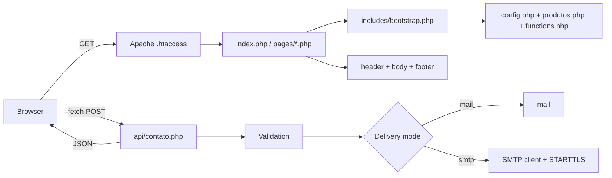

# ErlDev — Company Website

<div align="center">


**The ErlDev company website — PHP 8 + vanilla JS/CSS, zero dependencies, no build step**

[](https://php.net)
[](https://developer.mozilla.org/docs/Web/JavaScript)
[](https://developer.mozilla.org/docs/Web/CSS)
[](https://httpd.apache.org)
[](https://www.erldev.com.br)
[](https://www.erldev.com.br)

[⭐ Highlights](#-engineering-highlights) • [📋 Features](#-features) • [🛠 Stack](#-tech-stack) • [🏗 Architecture](#-architecture) • [🚀 Products](#-product-showcase)

</div>

---

## 🌍 Language / Idioma

<table>
<tr>
<td align="center"><a href="README.md"><b>🇧🇷 Português</b></a><br><sub>Versão em português</sub></td>
<td align="center"><b>🇺🇸 English</b><br><sub>You are here</sub></td>
</tr>
</table>

---

## 🎯 Overview

The website of **ErlDev**, an engineering studio that builds custom web systems, PWAs and automations, is **live at [www.erldev.com.br](https://www.erldev.com.br)**. It presents the company to small and mid-size businesses that need custom software, acts as the **showcase hub for the products in this portfolio**, and takes inbound enquiries through its own contact form.

The technical approach is deliberate: a lightweight site with **no frameworks, no package manager and no build step**, where the code itself demonstrates care for performance, accessibility and SEO.

### The Challenge

Ship a complete, fast, easy-to-maintain company site without inheriting the weight of dependencies:
- Shared Apache/PHP hosting with simple upload-based publishing
- Light/dark theme switching with no flash on first paint
- Sending the contact form's email without a third-party library
- Multiple product pages without duplicating HTML for every new launch

### The Solution

A PHP 8 site with semantic HTML, CSS custom properties and a single vanilla JavaScript file. Products live in a config-driven catalogue rendered by **one shared template**, and the contact form talks to a dedicated endpoint that speaks SMTP directly.

---

## ⭐ Engineering Highlights

- **Hand-written SMTP client, no library**: parses multi-line replies correctly, negotiates **STARTTLS** and logs each step for diagnostics; delivery can switch between `mail()` and SMTP through configuration
- **Config-driven product catalogue**: four detail pages come from **one shared template**; each page is a 19-line wrapper, and adding a product is one array entry plus one wrapper
- **Flash-free light/dark theme**: an inline script applies the saved theme before first paint, and the hero canvas follows the theme through a `MutationObserver`
- **Dependency-free animated hero**: a canvas renderer draws compass arcs and a plotter-style sweep line, switched off under `prefers-reduced-motion`
- **Real accessibility work**: skip link, `aria-label`/`aria-expanded`, `:focus-visible`, Escape-to-close menu and form feedback with `role="status"`
- **Aggressive caching with automatic invalidation**: one-year `immutable` asset caching, versioned by each file's `filemtime`
- **Complete SEO setup**: Open Graph, Twitter Cards, canonical URL, `sitemap.xml`, `robots.txt` and a web app manifest
- **Zero dependencies**: no `package.json`, no `composer.json`, no build; inline SVG icons instead of an icon library

---

## 📋 Features

### 🏠 Public Site

- **Hero** with a canvas animation that reads the current theme's ink colour
- **Services, process, "why us" and technology** sections
- **Technology marquee** looping continuously, with the tile grid duplicated into a track
- **Scroll reveal** using `IntersectionObserver`
- Accessible **mobile menu** with `aria-expanded` and Escape to close
- **Theme toggle** persisted in `localStorage`
- Custom 404 page

---

### 🧩 Product Catalogue

Four products presented as case studies, each with copy, features, colour tokens, stack and status, all defined in one config file and rendered by the same template. A product logo falls back to an SVG icon if the image file is missing.

---

### ✉️ Contact Form

- Submitted with `fetch` and `FormData`, with a JSON response
- POST-only endpoint with a **honeypot**, required-field checks, **length limits**, email validation and a **per-session rate limit**
- Delivery through `mail()` or a **custom SMTP client** with STARTTLS, switchable in configuration
- Credentials kept out of version control

---

### 🔎 SEO & Discoverability

- Open Graph and Twitter Card tags, canonical URL and per-page titles
- `sitemap.xml`, `robots.txt` and `site.webmanifest`
- Canonical-host (`www`) redirect and extension-less URLs through `.htaccess`

---

### ⚡ Performance

- gzip compression and one-year `immutable` caching for static assets
- `filemtime` cache-busting in the `asset()` helper
- `loading="lazy"` on product logos
- Inline SVG icons, so no extra requests

---

## 🚀 Product Showcase

The ErlDev website is the **hub** that introduces the other products in this portfolio. Each has its own documentation in this repository:

| Product | Documentation |
|---------|---------------|
| **American Teens** | [View portfolio](../American%20Teens%20Portifolio/) |
| **GynConect** | [View portfolio](../GynConect%20Portfolio/) |
| **Louvor ADE** | [View portfolio](../Louvor%20ADE%20Portfolio/) |
| **ErlDev Gestão** | [View portfolio](../ErlDev%20Gestao%20Portfolio/) |

---

## 🛠 Tech Stack

| Layer | Technology |
|-------|-----------|
| **Backend** | PHP 8, no framework, routing handled by Apache |
| **Frontend** | Semantic HTML5 + CSS3 (custom properties) + vanilla JavaScript |
| **Server** | Apache with `mod_rewrite`, `mod_expires`, `mod_deflate` and `mod_headers` |
| **Email** | `mail()` or a custom socket-based SMTP client with STARTTLS |
| **Typography** | Manrope and JetBrains Mono (Google Fonts) |
| **Icons** | Inline SVG |
| **Dependencies** | None, no build |
| **Deployment** | Shared Apache hosting, FTP upload |

---

## 🏗 Architecture

No MVC, router or ORM. Apache handles URLs, and every page includes a `bootstrap.php` that defines the guard constant and loads configuration, the catalogue and helpers.



```
/erldev
  index.php        main page
  404.php          error page
  /pages           product pages (19-line wrappers)
  /api             contact form endpoint
  /includes        bootstrap, header/menu/footer, helpers, product template
  /config          general settings and product catalogue
  /assets          css (reset, variables, main), js (main.js), images
```

---

## 📊 Project Summary

| Aspect | Details |
|--------|---------|
| **Type** | Company website and product showcase |
| **Stack** | PHP 8, vanilla JavaScript, CSS3, Apache |
| **Code size** | ~4.1k lines (PHP 1,741, JS 323, CSS 2,052) |
| **Code files** | 20 (16 PHP, 1 JS, 3 CSS) |
| **Public pages** | 6 (home, 4 products, 404) |
| **API endpoints** | 1 (contact form, POST) |
| **Database** | None |
| **Dependencies** | 0 |
| **Status** | Live: [www.erldev.com.br](https://www.erldev.com.br) |

---

## 👨‍💻 About the Developer

**Lucas (Erl Dev)** — Full-Stack Developer | PWA Specialist

- 🌐 Portfolio: [github.com/Lucas12teixeira/Portifolio-Projetos](https://github.com/Lucas12teixeira/Portifolio-Projetos)
- 💼 LinkedIn: [www.linkedin.com/in/lucas-lima-10218529a/](https://www.linkedin.com/in/lucas-lima-10218529a/)
- 🐙 GitHub: [@Lucas12teixeira](https://github.com/Lucas12teixeira)
- 🏢 Company site: [www.erldev.com.br](https://www.erldev.com.br)

---

## 📜 License & Rights

© 2024-2026 Lucas (Erl Dev). All rights reserved.

> This repository contains **portfolio documentation only**. Source code is proprietary and not included.

---

<div align="center">

[📋 Executive Summary](PROJECT_SUMMARY.md) • [🇧🇷 Português](README.md)

**Built with ❤️ and ☕ by [Lucas (Erl Dev)](https://github.com/Lucas12teixeira/Portifolio-Projetos)**

</div>
