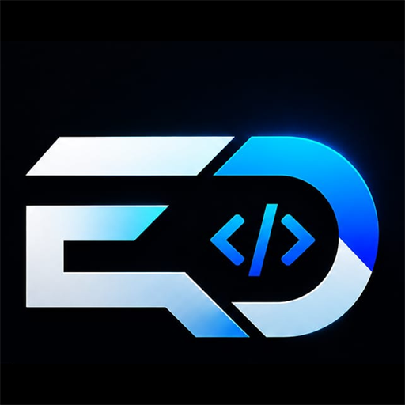
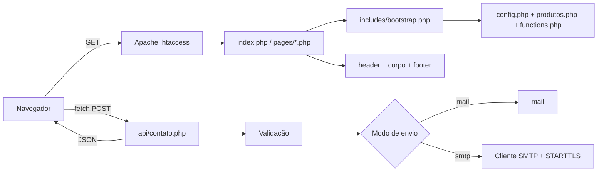

# ErlDev — Site Institucional

<div align="center">



**Site institucional da ErlDev — PHP 8 + JS/CSS vanilla, zero dependências, sem build**

[](https://php.net)
[](https://developer.mozilla.org/docs/Web/JavaScript)
[](https://developer.mozilla.org/docs/Web/CSS)
[](https://httpd.apache.org)
[](https://www.erldev.com.br)
[](https://www.erldev.com.br)

[⭐ Destaques](#-destaques-de-engenharia) • [📋 Funcionalidades](#-funcionalidades) • [🛠 Stack](#-stack-técnico) • [🏗 Arquitetura](#-arquitetura) • [🚀 Produtos](#-vitrine-de-produtos)

</div>

---

## 🌍 Idioma / Language

<table>
<tr>
<td align="center"><b>🇧🇷 Português</b><br><sub>Você está aqui</sub></td>
<td align="center"><a href="README-EN.md"><b>🇺🇸 English</b></a><br><sub>English version</sub></td>
</tr>
</table>

---

## 🎯 Visão Geral

O site da **ErlDev**, estúdio de engenharia que constrói sistemas web, PWA e automações sob medida, está **no ar em [www.erldev.com.br](https://www.erldev.com.br)**. Ele apresenta a empresa para pequenos e médios negócios que precisam de software sob medida, funciona como **vitrine e ponto de entrada dos produtos do portfólio** e recebe contatos por um formulário próprio.

A proposta técnica é deliberada: um site leve, **sem frameworks, sem gerenciador de pacotes e sem etapa de build**, em que o próprio código demonstra cuidado com performance, acessibilidade e SEO.

### O Desafio

Entregar um site institucional completo, rápido e fácil de manter, sem herdar o peso de dependências:
- Hospedagem compartilhada com Apache e PHP, publicação por upload simples
- Alternância de tema claro/escuro sem "piscar" na primeira renderização
- Envio de e-mail do formulário sem biblioteca de terceiros
- Várias páginas de produto sem duplicar HTML a cada novo lançamento

### A Solução

Um site PHP 8 com HTML semântico, CSS com custom properties e um único arquivo de JavaScript vanilla. Os produtos vivem em um catálogo configurável renderizado por **um template compartilhado**, e o formulário de contato conversa com um endpoint próprio que fala SMTP diretamente.

---

## ⭐ Destaques de Engenharia

- **Cliente SMTP escrito à mão, sem biblioteca**: lê respostas multilinha corretamente, negocia **STARTTLS** e registra cada etapa para diagnóstico; o envio pode alternar entre `mail()` e SMTP por configuração
- **Catálogo de produtos orientado a configuração**: quatro páginas de detalhe saem de **um template compartilhado**; cada página é um wrapper de 19 linhas, e adicionar um produto é uma entrada de array mais um wrapper
- **Tema claro/escuro sem flash**: um script inline aplica o tema salvo antes da primeira pintura, e o canvas do hero acompanha o tema via `MutationObserver`
- **Hero animado em canvas, sem dependências**: arcos de compasso e uma linha de varredura estilo plotter, desativados sob `prefers-reduced-motion`
- **Acessibilidade de verdade**: skip link, `aria-label`/`aria-expanded`, `:focus-visible`, menu fechável com Escape e feedback do formulário com `role="status"`
- **Cache agressivo com invalidação automática**: assets com cache de um ano e `immutable`, versionados pelo `filemtime` do arquivo
- **SEO completo**: Open Graph, Twitter Cards, URL canônica, `sitemap.xml`, `robots.txt` e web app manifest
- **Zero dependências**: sem `package.json`, sem `composer.json`, sem build; ícones em SVG inline, sem biblioteca de ícones

---

## 📋 Funcionalidades

### 🏠 Site Público

- **Hero** com animação em canvas que lê a cor de tinta do tema atual
- Seções de **serviços, processo, diferenciais e tecnologias**
- **Marquee de tecnologias** em loop contínuo, com a grade duplicada em uma trilha
- **Revelação ao rolar** com `IntersectionObserver`
- **Menu mobile** acessível, com `aria-expanded` e fechamento por Escape
- **Alternância de tema** persistida em `localStorage`
- Página 404 própria

---

### 🧩 Catálogo de Produtos

Quatro produtos apresentados como cases, cada um com descrição, funcionalidades, tokens de cor, stack e status, todos definidos em um arquivo de configuração e renderizados pelo mesmo template. O logo do produto cai para um ícone SVG se a imagem não existir.

---

### ✉️ Formulário de Contato

- Envio por `fetch` com `FormData` e resposta em JSON
- Endpoint somente POST, com **honeypot**, validação de campos obrigatórios, **limites de tamanho**, validação de e-mail e **limite de frequência por sessão**
- Entrega por `mail()` ou por **cliente SMTP próprio** com STARTTLS, alternável em configuração
- Credenciais mantidas fora do versionamento

---

### 🔎 SEO e Descoberta

- Tags Open Graph e Twitter Card, URL canônica e título por página
- `sitemap.xml`, `robots.txt` e `site.webmanifest`
- Redirecionamento para o host canônico (`www`) e URLs sem extensão `.php`, via `.htaccess`

---

### ⚡ Performance

- Compressão gzip e cache de um ano com `immutable` para estáticos
- Cache-busting por `filemtime` na função `asset()`
- `loading="lazy"` nos logos de produto
- Ícones em SVG inline, sem requisições extras

---

## 🚀 Vitrine de Produtos

O site da ErlDev é o **hub** que apresenta os demais produtos do portfólio. Cada um tem sua própria documentação neste repositório:

| Produto | Documentação |
|---------|--------------|
| **American Teens** | [Ver portfólio](../American%20Teens%20Portifolio/) |
| **GynConect** | [Ver portfólio](../GynConect%20Portfolio/) |
| **Louvor ADE** | [Ver portfólio](../Louvor%20ADE%20Portfolio/) |
| **ErlDev Gestão** | [Ver portfólio](../ErlDev%20Gestao%20Portfolio/) |

---

## 🛠 Stack Técnico

| Camada | Tecnologia |
|--------|-----------|
| **Backend** | PHP 8, sem framework, roteamento por Apache |
| **Frontend** | HTML5 semântico + CSS3 (custom properties) + JavaScript vanilla |
| **Servidor** | Apache com `mod_rewrite`, `mod_expires`, `mod_deflate` e `mod_headers` |
| **E-mail** | `mail()` ou cliente SMTP próprio sobre sockets, com STARTTLS |
| **Tipografia** | Manrope e JetBrains Mono (Google Fonts) |
| **Ícones** | SVG inline |
| **Dependências** | Nenhuma, sem build |
| **Publicação** | Hospedagem compartilhada Apache, upload por FTP |

---

## 🏗 Arquitetura

Sem MVC, roteador ou ORM. O Apache cuida das URLs, e cada página inclui um `bootstrap.php` que define a constante de guarda e carrega configuração, catálogo e helpers.



```
/erldev
  index.php        página principal
  404.php          página de erro
  /pages           páginas de produto (wrappers de 19 linhas)
  /api             endpoint do formulário de contato
  /includes        bootstrap, header/menu/footer, helpers, template de produto
  /config          configuração geral e catálogo de produtos
  /assets          css (reset, variables, main), js (main.js), imagens
```

---

## 📊 Resumo do Projeto

| Aspecto | Detalhes |
|---------|---------|
| **Tipo** | Site institucional e vitrine de produtos |
| **Stack** | PHP 8, JavaScript vanilla, CSS3, Apache |
| **Código** | ~4,1 mil linhas (PHP 1.741, JS 323, CSS 2.052) |
| **Arquivos de código** | 20 (16 PHP, 1 JS, 3 CSS) |
| **Páginas públicas** | 6 (início, 4 produtos, 404) |
| **Endpoints de API** | 1 (formulário de contato, POST) |
| **Banco de dados** | Nenhum |
| **Dependências** | 0 |
| **Status** | No ar: [www.erldev.com.br](https://www.erldev.com.br) |

---

## 👨‍💻 Sobre o Desenvolvedor

**Lucas (Erl Dev)** — Full-Stack Developer | Especialista em PWA

- 🌐 Portfolio: [github.com/Lucas12teixeira/Portifolio-Projetos](https://github.com/Lucas12teixeira/Portifolio-Projetos)
- 💼 LinkedIn: [www.linkedin.com/in/lucas-lima-10218529a/](https://www.linkedin.com/in/lucas-lima-10218529a/)
- 🐙 GitHub: [@Lucas12teixeira](https://github.com/Lucas12teixeira)
- 🏢 Site da empresa: [www.erldev.com.br](https://www.erldev.com.br)

---

## 📜 Licença e Direitos

© 2024-2026 Lucas (Erl Dev). Todos os direitos reservados.

> Este repositório contém apenas **documentação de portfólio**. O código-fonte é proprietário e não está incluído.

---

<div align="center">

[📋 Resumo Executivo](PROJECT_SUMMARY.md) • [🇺🇸 English](README-EN.md)

**Desenvolvido com ❤️ e ☕ por [Lucas (Erl Dev)](https://github.com/Lucas12teixeira/Portifolio-Projetos)**

</div>
