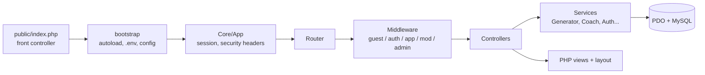

# FitPersonal AI — Strength-Training PWA with a Deterministic Rule Engine

**Personalized, versioned workout plans from an in-house, tested rule engine, with no paid APIs**

[⭐ Highlights](#-engineering-highlights) • [📋 Features](#-features) • [🛠 Stack](#-tech-stack) • [🏗 Architecture](#-architecture) • [🔒 Security](#-security--privacy)

---

## 🌍 Language / Idioma

<table>
<tr>
<td align="center"><a href="README.md"><b>🇧🇷 Português</b></a> Versão em português</td>
<td align="center"><b>🇺🇸 English</b> You are here</td>
</tr>
</table>

---

## 🎯 Overview

**FitPersonal AI** is a Progressive Web App (UI in Brazilian Portuguese) for strength training. For adults who train at a gym or at home, it generates a personalized plan from a 7-step questionnaire, logs every workout session, and shows progress based on the user's real data.

The "AI" in the name is an **in-house deterministic rule engine**: the same input and seed always produce the same plan. There is no LLM and no third-party API, and no data leaves the server. The whole system runs on shared hosting (PHP + MySQL).

> ⚠️ **Health disclaimer:** FitPersonal AI does not replace guidance from a healthcare or fitness professional. When the answers indicate risk, the app stops plan generation and refers the user to a professional.

### The Problem

People who train without a personal trainer rarely get a structured plan that accounts for their goal, equipment, available time and injuries. Generic spreadsheets don't adapt, and nothing guarantees a routine is safe for someone reporting pain or lacking medical clearance.

### The Solution

An installable app that runs a health screening and **refuses to generate a plan when risk signals appear**. When it is safe to proceed, it generates a validated, versioned plan, guides the live session (rest timer, load suggestions from the last session, resume after interruption), and turns the history into progress charts.

---

## ⭐ Engineering Highlights

- **Deterministic, validated generation engine**: exercise scoring, split selection by frequency and level, time fitting, and independent validation before saving; errors block the save. Parameters are editable from the admin panel.
- **Safety gate ahead of generation**: pain, injury or missing clearance stops plan creation and refers the user to a professional.
- **Versioned plans**: no plan is ever overwritten; every edit creates a new version, and exercise swaps only offer compatible alternatives.
- **Designed for shared hosting**: no framework and no Composer; a DB-backed rate limiter with lazy cleanup, an SMTP client with STARTTLS, and WebAuthn with a CBOR reader, all written in-house.
- **Global session revocation** via an epoch counter, with no scanning of session files, and **timing-equalized login** (dummy hash for unknown emails).
- **Hardened image pipeline**: uploads are validated by MIME and re-encoded through GD, stripping EXIF and metadata; files are stored outside the web root.
- **Service worker that never caches personal pages**: HTML is network-only and versioned caches are purged on each release.
- **Test suite with 67 cases** (30 unit + 37 integration) covering IDOR, CSRF, XSS and SQL injection; the integration run refuses to start unless the database name ends in `_test`.

---

## 📋 Features

### 🔐 Authentication & Accounts

- Registration with passwords of at least 10 characters and a blocklist of common passwords
- Login with generic error messages (resistant to user enumeration)
- Password reset, email verification and "sign out everywhere"
- **Biometric login (passkeys/WebAuthn)**, up to 10 devices per user

### 🧭 Onboarding & Screening

- 7 server-validated steps plus a final review
- Separate, revocable consent for health data
- Safety screening before any plan is generated

### 🏋️ Generator & Plans

- Pure, seeded, reproducible function
- Training split chosen by weekly frequency and level
- Volume fitted to the available time
- Plan versioning and swaps limited to compatible alternatives

### ⏱ Live Workout Session

- **Idempotent** set saving
- Load suggestions based on the last session
- Rest timer, resume after interruption and Wake Lock

### 📚 Exercise Library

- **101 exercises**, with filters and alternatives
- **59 licensed illustrations** (CC BY-SA 3.0, Everkinetic via wger and Wikimedia Commons), served through a dedicated controller
- In the admin, creating exercises and media requires a source and a license

### 🤖 Coach (rule-based)

- Rule-based assistant, **not an LLM**
- Splits compound questions and answers from the user's own plan and loads
- Refuses diagnosis, drugs and supplements, and refers pain reports to a professional
- Processing stays entirely on the server

### 📈 Progress

- Period comparison, weekly goals and body metrics
- Per-exercise charts rendered server-side as SVG
- Achievements

### 👥 Community (opt-in)

- Profiles, posts with an optional attached stat, likes and comments
- Reports, blocks and a moderator queue

### 🛡 Admin & RBAC

- Roles: user, moderator and admin
- User management and role grants (granting admin requires password confirmation)
- Exercise and media CRUD, generator configuration, audit log and a migration runner

### 📱 PWA

- Manifest with 3 icons and 3 shortcuts, a service worker with versioned caches, and an offline page

---

## 🛠 Tech Stack

| Layer | Technology |
|-------|-----------|
| **Backend** | Plain PHP 7.4+ (no framework, no Composer), PDO |
| **Database** | MySQL 5.7+/8 or MariaDB 10.4+ (39 tables) |
| **Frontend** | Vanilla JavaScript, hand-written CSS, Lucide icon sprite, self-hosted Inter and Barlow Condensed fonts |
| **Mobile** | PWA with manifest, service worker and offline page |
| **Auth** | PHP session + WebAuthn (CBOR, ES256/RS256, signature counter) |
| **Email** | In-house SMTP client (STARTTLS/SSL, AUTH LOGIN) |
| **Integrations** | No third-party APIs; no runtime dependencies |
| **Testing** | Custom dependency-free PHP runner |

---

## 🏗 Architecture

- `public/` is the only web root; `app/`, `config/`, `database/` and `storage/` live outside it
- Layers: `Core/` (kernel, router, request/response, PDO, session, CSRF, logger), `Controllers/`, `Services/`, `Repositories/` and `Views/`
- **39-table** schema covering users, profiles, screenings, exercises and media, plans (days and exercises), sessions and sets, metrics, goals, achievements, community, audit, rate limits and WebAuthn credentials
- A base schema plus SQL migrations for upgrades
- **122 registered routes**, 10 of which are JSON endpoints under `/api/` (biometrics, workout and progress)

---

## 🔒 Security & Privacy

- **PDO prepared statements** for queries
- **CSRF**: 256-bit per-session token, compared with `hash_equals`
- **Passwords**: `password_hash` / `password_verify` with automatic rehash
- **Sessions**: HttpOnly, SameSite=Lax, Secure under HTTPS, strict mode, cookies only
- **DB-backed rate limiting** (login, registration, password reset, assistant and biometrics)
- **Headers**: CSP with `script-src 'self'` and `frame-ancestors 'none'`, X-Frame-Options, nosniff, Referrer-Policy, Permissions-Policy, COOP and HSTS under HTTPS
- **Logs** redact sensitive fields; the audit log stores IPs only as an HMAC
- **WebAuthn**: single-use 300 s challenge, origin and RP-ID checks, user verification and a counter check
- **LGPD (Brazilian data protection law)**: JSON data export, health-consent revocation, account deletion, a privacy page and a data & privacy document

---

## ✅ Quality

- **Test suite with 67 cases**: 30 unit (25 generator + 5 coach) and 37 integration
- Integration tests start a local server and require a dedicated database with a `_test` suffix
- Project docs: deployment guide, generator documentation and a data & privacy document
- Deployment target: shared hosting with PHP, MySQL/MariaDB and HTTPS

---

## 📊 Project Summary

| Aspect | Details |
|--------|---------|
| **Type** | Strength-training PWA with rule-based plan generation |
| **Stack** | PHP 7.4+, MySQL/MariaDB, Vanilla JavaScript, PWA |
| **Tables** | 39 |
| **Routes** | 122 (10 JSON under `/api/`) |
| **Test cases** | 67 (30 unit + 37 integration) |
| **Exercises** | 101, with 59 licensed illustrations |
| **Code size** | ~17k lines of PHP, ~1.4k of JavaScript, ~1.7k of CSS |
| **Paid APIs** | None |
| **Status** | MVP |

---

## 👨‍💻 About the Developer

**Lucas (Erl Dev)** — Full-Stack Developer | PWA Specialist

- 🌐 Portfolio: [github.com/Lucas12teixeira/Portifolio-Projetos](https://github.com/Lucas12teixeira/Portifolio-Projetos)
- 💼 LinkedIn: [www.linkedin.com/in/lucas-lima-10218529a/](https://www.linkedin.com/in/lucas-lima-10218529a/)
- 🐙 GitHub: [@Lucas12teixeira](https://github.com/Lucas12teixeira)
- 🏢 Erl Dev: [www.erldev.com.br](https://www.erldev.com.br)

---

## 📜 License & Rights

© 2024-2026 Lucas (Erl Dev). All rights reserved.

> This repository contains **portfolio documentation only**. Source code is proprietary and not included.
>
> The project's exercise illustrations are by Everkinetic (via wger and Wikimedia Commons) under CC BY-SA 3.0.

---

[📋 Executive Summary](PROJECT_SUMMARY.md) • [🇧🇷 Português](README.md)

**Built with ❤️ and ☕ by [Lucas (Erl Dev)](https://github.com/Lucas12teixeira/Portifolio-Projetos)**

