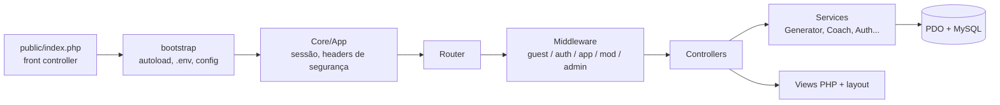

# FitPersonal AI — PWA de Treino de Força com Motor de Regras Determinístico

**Planos de treino personalizados e versionados, gerados por um motor de regras próprio, testado e sem APIs pagas**

[⭐ Destaques](#-destaques-de-engenharia) • [📋 Funcionalidades](#-funcionalidades) • [🛠 Stack](#-stack-técnico) • [🏗 Arquitetura](#-arquitetura) • [🔒 Segurança](#-segurança-e-privacidade)

---

## 🌍 Idioma / Language

<table>
<tr>
<td align="center"><b>🇧🇷 Português</b> Você está aqui</td>
<td align="center"><a href="README-EN.md"><b>🇺🇸 English</b></a> English version</td>
</tr>
</table>

---

## 🎯 Visão Geral

**FitPersonal AI** é um Progressive Web App em português (pt-BR) para treino de força. Para adultos que treinam na academia ou em casa, ele gera um plano personalizado a partir de um questionário de 7 etapas, registra cada sessão de treino e mostra a evolução com base nos dados reais do usuário.

O "AI" do nome é um **motor de regras determinístico, desenvolvido internamente**: mesma entrada e mesma semente produzem o mesmo plano. Não há LLM nem API de terceiros, e nenhum dado sai do servidor. O sistema roda em hospedagem compartilhada (PHP + MySQL).

> ⚠️ **Aviso de saúde:** o FitPersonal AI não substitui a orientação de um profissional de saúde ou de educação física. Quando as respostas indicam risco, o app interrompe a geração e encaminha o usuário a um profissional.

### O Problema

Quem treina sem personal trainer raramente tem um plano estruturado que considere objetivo, equipamentos, tempo disponível e lesões. Planilhas genéricas não se adaptam, e nada garante que o treino seja seguro para quem relata dor ou ainda não tem liberação médica.

### A Solução

Um app instalável que faz uma triagem de saúde e **recusa gerar o plano quando há sinais de risco**. Quando é seguro, gera um plano validado e versionado, guia a sessão ao vivo (cronômetro de descanso, sugestão de carga com base na última sessão, retomada após interrupção) e transforma o histórico em gráficos de progresso.

---

## ⭐ Destaques de Engenharia

- **Motor de geração determinístico e validado**: pontuação de exercícios, escolha de divisão por frequência e nível, ajuste ao tempo disponível e validação independente antes de salvar; erros bloqueiam o salvamento. Parâmetros editáveis no painel admin.
- **Portão de segurança antes da geração**: dor, lesão ou falta de liberação interrompem a criação do plano e encaminham o usuário a um profissional.
- **Planos versionados**: nenhum plano é sobrescrito; cada edição cria uma nova versão, e a troca de exercício só oferece alternativas compatíveis.
- **Projetado para hospedagem compartilhada**: sem framework e sem Composer; rate limiter em banco com limpeza preguiçosa, cliente SMTP com STARTTLS e WebAuthn com leitor CBOR, todos escritos internamente.
- **Revogação global de sessões** por contador de época (*epoch*), sem varrer arquivos de sessão, e login com **equalização de tempo** (hash fictício para e-mails inexistentes).
- **Pipeline de imagens seguro**: uploads revalidados por MIME e recodificados via GD, o que remove EXIF e metadados; arquivos ficam fora do web root.
- **Service worker que não cacheia páginas pessoais**: HTML sempre vai à rede, e caches versionados são limpos a cada release.
- **Suíte de testes com 67 casos** (30 unitários + 37 de integração) que cobre IDOR, CSRF, XSS e SQL injection; a execução de integração recusa rodar se o banco não terminar em `_test`.

---

## 📋 Funcionalidades

### 🔐 Autenticação e Contas

- Cadastro com senha de no mínimo 10 caracteres e lista de senhas proibidas
- Login com mensagens genéricas (resistente a enumeração de usuários)
- Recuperação de senha, verificação de e-mail e "sair de todos os dispositivos"
- **Login biométrico (passkeys/WebAuthn)**, com até 10 dispositivos por usuário

### 🧭 Onboarding e Triagem

- 7 etapas validadas no servidor, mais revisão final
- Consentimento específico para dados de saúde, revogável
- Triagem de segurança antes de qualquer geração de plano

### 🏋️ Gerador e Planos

- Função pura, com semente, reproduzível
- Divisão de treino escolhida por frequência semanal e nível
- Ajuste do volume ao tempo disponível
- Versionamento de planos e troca de exercícios por alternativas compatíveis

### ⏱ Sessão de Treino ao Vivo

- Salvamento de séries **idempotente**
- Sugestão de carga com base na última sessão
- Cronômetro de descanso, retomada após interrupção e Wake Lock

### 📚 Biblioteca de Exercícios

- **101 exercícios**, com filtros e alternativas
- **59 ilustrações licenciadas** (CC BY-SA 3.0, Everkinetic via wger e Wikimedia Commons), servidas por um controller dedicado
- No admin, cadastro de exercícios e mídias exige informar fonte e licença

### 🤖 Coach (baseado em regras)

- Assistente por regras, **não é um LLM**
- Divide perguntas compostas e responde com base no plano e nas cargas do próprio usuário
- Recusa diagnóstico, medicamentos e suplementos, e encaminha relatos de dor a um profissional
- Processamento 100% local ao servidor

### 📈 Progresso

- Comparação entre períodos, metas semanais e medidas corporais
- Gráficos por exercício renderizados no servidor em SVG
- Conquistas

### 👥 Comunidade (opt-in)

- Perfis, posts com estatística opcional anexada, curtidas e comentários
- Denúncias, bloqueios e fila de moderação

### 🛡 Admin e RBAC

- Perfis: usuário, moderador e admin
- Gestão de usuários e concessão de papéis (concessão de admin exige confirmação de senha)
- CRUD de exercícios e mídias, configuração do gerador, log de auditoria e executor de migrações

### 📱 PWA

- Manifest com 3 ícones e 3 atalhos, service worker com caches versionados e página offline

---

## 🛠 Stack Técnico

| Camada | Tecnologia |
|--------|-----------|
| **Backend** | PHP 7.4+ puro (sem framework, sem Composer), PDO |
| **Banco de dados** | MySQL 5.7+/8 ou MariaDB 10.4+ (39 tabelas) |
| **Frontend** | JavaScript Vanilla, CSS escrito à mão, sprite de ícones Lucide, fontes Inter e Barlow Condensed auto-hospedadas |
| **Mobile** | PWA com manifest, service worker e página offline |
| **Autenticação** | Sessão PHP + WebAuthn (CBOR, ES256/RS256 e contador de assinatura) |
| **E-mail** | Cliente SMTP próprio (STARTTLS/SSL, AUTH LOGIN) |
| **Integrações** | Nenhuma API de terceiros; nenhuma dependência de runtime |
| **Testes** | Runner PHP próprio, sem dependências |

---

## 🏗 Arquitetura

- `public/` é o único web root; `app/`, `config/`, `database/` e `storage/` ficam fora dele
- Camadas: `Core/` (kernel, router, request/response, PDO, sessão, CSRF, logger), `Controllers/`, `Services/`, `Repositories/` e `Views/`
- Banco com **39 tabelas** cobrindo usuários, perfis, triagens, exercícios e mídias, planos (dias e exercícios), sessões e séries, métricas, metas, conquistas, comunidade, auditoria, rate limits e credenciais WebAuthn
- Schema base mais migrações SQL para upgrades
- **122 rotas registradas**, das quais 10 são endpoints JSON em `/api/` (biometria, treino e progresso)

---

## 🔒 Segurança e Privacidade

- **PDO com prepared statements** nas consultas
- **CSRF**: token de 256 bits por sessão, comparado com `hash_equals`
- **Senhas**: `password_hash` / `password_verify`, com rehash automático
- **Sessões**: HttpOnly, SameSite=Lax, Secure sob HTTPS, modo estrito, somente cookies
- **Rate limiting** em banco (login, cadastro, reset de senha, assistente e biometria)
- **Cabeçalhos**: CSP com `script-src 'self'` e `frame-ancestors 'none'`, X-Frame-Options, nosniff, Referrer-Policy, Permissions-Policy, COOP e HSTS sob HTTPS
- **Logs** com redação de campos sensíveis; o log de auditoria guarda o IP apenas como HMAC
- **WebAuthn**: desafio de uso único com validade de 300 s, checagem de origem e RP-ID, verificação de usuário e contador
- **LGPD**: exportação dos dados em JSON, revogação do consentimento de saúde, exclusão de conta, página de privacidade e documento de dados e privacidade

---

## ✅ Qualidade

- **Suíte de testes com 67 casos**: 30 unitários (25 do gerador + 5 do coach) e 37 de integração
- Testes de integração sobem um servidor local e exigem banco dedicado com sufixo `_test`
- Documentação própria: guia de deploy, documentação do gerador e de dados e privacidade
- Alvo de deploy: hospedagem compartilhada com PHP, MySQL/MariaDB e HTTPS

---

## 📊 Resumo do Projeto

| Aspecto | Detalhes |
|---------|---------|
| **Tipo** | PWA de treino de força com geração de planos por regras |
| **Stack** | PHP 7.4+, MySQL/MariaDB, JavaScript Vanilla, PWA |
| **Tabelas** | 39 |
| **Rotas** | 122 (10 JSON em `/api/`) |
| **Casos de teste** | 67 (30 unitários + 37 de integração) |
| **Exercícios** | 101, com 59 ilustrações licenciadas |
| **Código** | ~17 mil linhas de PHP, ~1,4 mil de JavaScript, ~1,7 mil de CSS |
| **APIs pagas** | Nenhuma |
| **Status** | MVP |

---

## 👨‍💻 Sobre o Desenvolvedor

**Lucas (Erl Dev)** — Full-Stack Developer | Especialista em PWA

- 🌐 Portfolio: [github.com/Lucas12teixeira/Portifolio-Projetos](https://github.com/Lucas12teixeira/Portifolio-Projetos)
- 💼 LinkedIn: [www.linkedin.com/in/lucas-lima-10218529a/](https://www.linkedin.com/in/lucas-lima-10218529a/)
- 🐙 GitHub: [@Lucas12teixeira](https://github.com/Lucas12teixeira)
- 🏢 Erl Dev: [www.erldev.com.br](https://www.erldev.com.br)

---

## 📜 Licença e Direitos

© 2024-2026 Lucas (Erl Dev). Todos os direitos reservados.

> Este repositório contém apenas **documentação de portfólio**. O código-fonte é proprietário e não está incluído.
>
> As ilustrações de exercícios do projeto são do Everkinetic (via wger e Wikimedia Commons), sob licença CC BY-SA 3.0.

---

[📋 Resumo Executivo](PROJECT_SUMMARY.md) • [🇺🇸 English](README-EN.md)

**Desenvolvido com ❤️ e ☕ por [Lucas (Erl Dev)](https://github.com/Lucas12teixeira/Portifolio-Projetos)**

